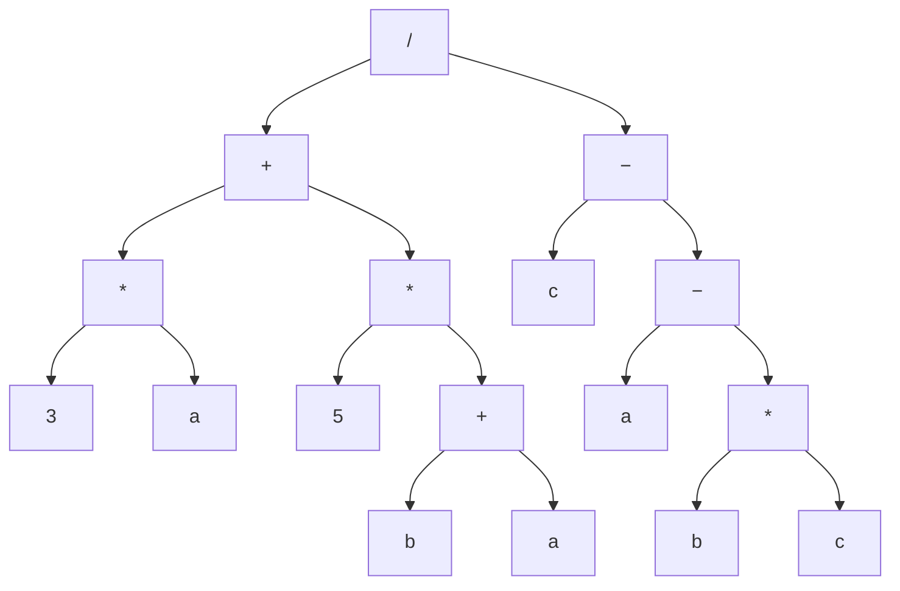
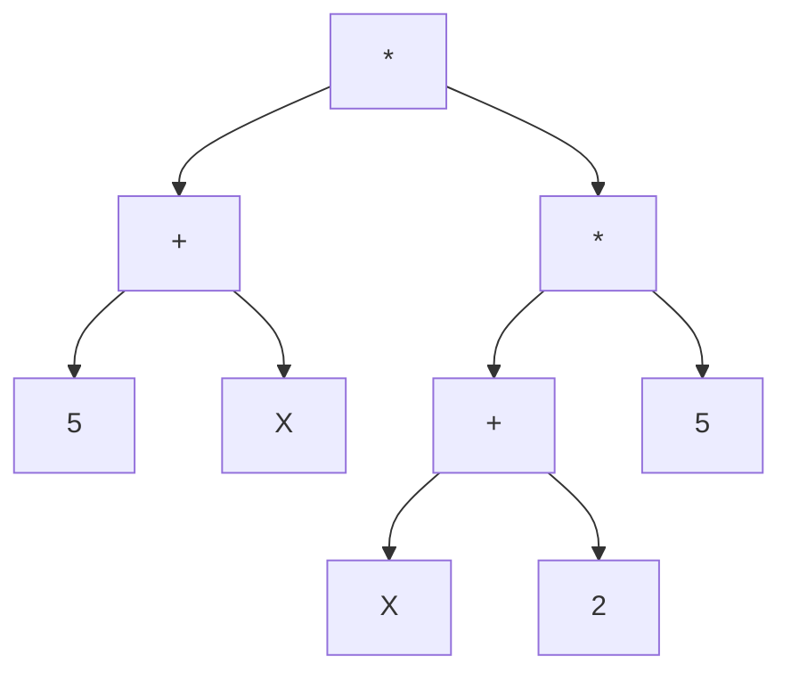

- Saturday October 31
- DCC
- 100 minutes
- Multiple and short answer questions

- Main topics
	- Querying in KB
	- Back chaining
	- List matching and list recursion
	- CSPs

# Knowledge Bases and Queries

- A knowledge base is a list of atomic statements defining what is true
- Queries allow use to use those statements to make interesting inferences about the world specified by the knowledge base

```prolog
inStore(ItemID, ProductType, Quantity)

manufacturer(ItemID, Company, Year)
```

**Q** - What product does the store have the most of?

```prolog
inStore(I1, P1, Q1), not (inStore(I2, P2, Q2), Q2 > Q1).
```

**Q** - What apple product does the store have the most of?

```
```prolog
inStore(I1, P1, Q1), manufactuer(I1, apple, Y),
not(inStore(I2, P2, Q2), Q2 > Q1), manufacturer(I2, apple, Y2)
```

# Rules and Back Chaining

- Rules specify additional relationships, useful for deducing more information

```prolog
head :- body1, body2, ..., bodyN
```

- Query
	- Given a KB, establish establish sentence Q is true
		- If Q is in KB, done
		- Find a sentence that matches with "Q :-"

**Q** - `ancestor(bob, mary)`

```prolog
1) parent(bob, steve).
2) parent(ann, bob).
3) parent(steve, peter).
4) parent(steve, sue).
5) parent(peter, mary).
6) parent(mary, john).
7) ancestor(X, Y) :- parent(X, Y).
8) ancestor(X, Y) :- parent(X, Z), ancestor(Z, Y).

X = bob
Y = mary
Match on 7, fails on parent(bob, mary)
Match on 8, parent(bob, Z), ancestor(Z, mary)
Z = steve
ancestor(steve, mary)
X = steve
Y = mary
Match on 7, fail on parent(steve, mary)
Match on 8, (steve, Z), ancestor(Z, mary)
Z = peter
ancestor(peter, mary)
match on 7, parent(peter, mary)
X = peter
Y = mary
Match on 5, success of parent(peter, mary)

7, 8, 1, 7, 8, 3, 7, 5
```

# Matching Lists

```prolog
[K, L | [M | N]] and [cps | [mth | [phy]]]

[K, L, M | N]

[cps, [mth, phy]]
[cps, mth, phy, []]

K = cps
L = mth
M = phy
N = []
```

```prolog
[X, c, b | [c | X]] and [[p, q]| [c, b, c]| [p, q, r]]

[X, c, b, c | X]

[[p, q]| [c, b, c, p, q, r]]
[[p, q]| c, b, c, p, q, r]
[[p, q]| c, b, c | [p, q, r]]

X = [p, q]
c, b, c = c, b, c
X /= [p, q, r]
```

# Recursion on Lists

```prolog
length([], 0).

length([H|T], N) := length(T, N2), N is N2 + 1 
```

# Recursion with Arithmetics

- What is the sum of `1 + 2 + 3 + ... + N?`

```prolog
seriesSum(N, Sum) :- Sum is N * (N+1)/2
```

- $1^2 + 2^2 + 3^2 + ... N^2$

```prolog
% recursing down
sumSquared(0, 0).

sumSquared(N, Sum) :- N > 0, N2 is N - 1, sumSquared(N2, S2), Sum is N^2 + S2.

----
% recursing up

SumH(N, N, S) :- S is N * N.
SumH(N1, N, S) :- M1 < N, N2 is N + 1, SumH(N2, S2), S is N1^2 + S2.
sumSquared(N, Sum) :- sumH(0, N, Sum)


```

# Newton-Raphson Algorithm

- Method for finding better and better approximations for the roots of real-valued functions
	- Fine the value of x that makes $f(x) = 0$
- Let $x_i $be the current approximation
	- Set $x_i$ with random guess
	- Calculate the tangent at $f(x_i)$
	- Set $x_{i+1}$ to be where tangent intersects x-axis
	- Go tangent calc again

Tangent line

$y = f'(x_0)(x-x_0)+f(x_0)$

Hits the x-axis at

$y = f'(x_0)(x-x_0)+f(x_0)$

Solve for x to get the intercept

$y = f'(x_0)(x-x_0)+f(x_0)$


```prolog
```

## Computing Square Root of Numbers

- Can use Newton-Raphson to compute square rots
- For a given N, find X where $X^2 = N$
- Can find by looking for intercept of $f(x) =x^2-N$
	- $x^2 - N = 0$ => $x^2= N$
- $f'(x) = 2x$

## Newton-Raphson in Prolog

```prolog
number(N)
abs(X, Y)

muSQRT(N, Result)

nrSQRT(N, Last, Eps, Result)
% true when Result is an approx. of the square root that is within Eps of the correuct result

epsilon(E) :- E is 1/100,000
mySQRT(N, Result) :- not number(N), Result = "First arg. must be a number".
mySQRT(N, Result) :- number(N), First is N/2, epsilon(EPS), nrSQRT(N, First, Eps, Result)

% answer
nrSQRT(N, Xi, Eps, Xi) :- R is Xi^2 - N, abs(R, RA), RA < Eps.

nrSQRT(N, Xi, Eps, Result) :- R is Xi^2 - N, abs(R, RA), RA >= Eps, Next is 0.5(Xi + N/xi), nrSQRT(N, Next, Eps, Result).
```

# Arithmetic Abstract Syntax Trees

$(3a + 5(b+a))/(c-(a-(bc)))$

- Convert to a binary tree



a - 1
b - 5
c - -2

# Terms

- Can have more complex arguments

`person(isaac, netwon)`

# Arithmetics Using Terms

- Expressions with only sum and products
- A single variable with an input value
- Use following library predicates

$(5+X)*((X+2)*5)$




```prolog
expr(m, expr(a, 5, X), expr(m, expr(a, X, 2), 5)).
```

```prolog
evalPS(N, V, N) :- number(N).

evalPS(X, V, V) :- var(X).

evalPS(expr(a, L, R), V, Z) :- evalPS(L, V, Z1), evalPS(R, V, Z2), Z is Z1 + Z2

evalPS(expr(m, L, R), V, Z) :- evalPS(L, V, Z1), evalPS(R, V, Z2), Z is Z1 * Z2
```